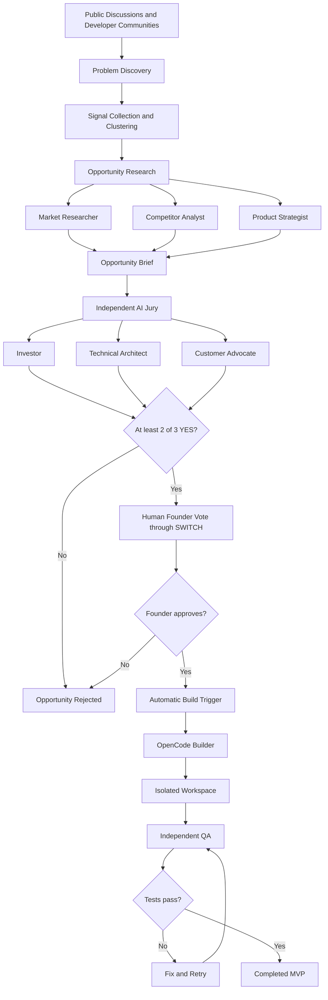
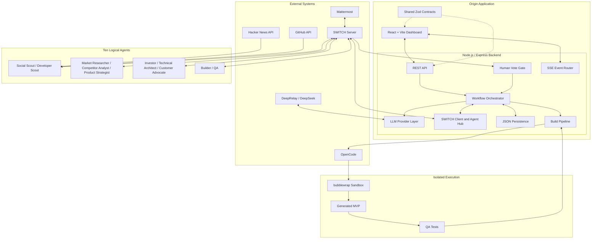
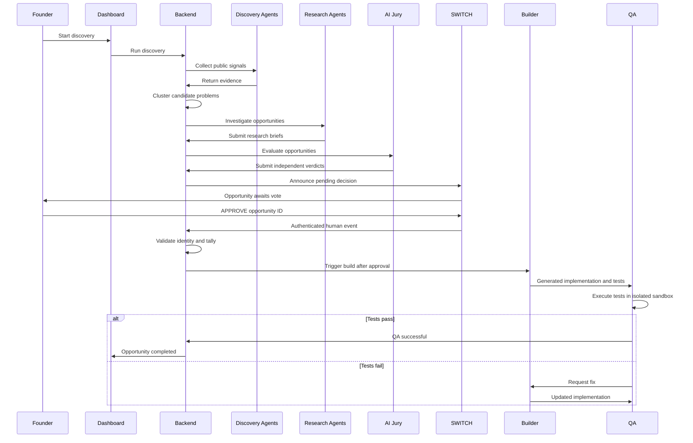

# Origin

### From problems to possibilities.

**An autonomous venture discovery and building studio powered by collaborative AI agents and SWITCH.**

Origin discovers real-world problems, investigates their potential, evaluates opportunities through independent AI perspectives and human judgment, and automatically builds and tests an MVP when an opportunity gets approved.

We don't start with random startup ideas. We start with problems worth solving.

<p align="center">
  <a href="https://youtu.be/R4B3zX1QxRE">
    
  </a>
  <br/>
  <a href="https://youtu.be/R4B3zX1QxRE"><strong>Watch the Origin Demo</strong></a>
  ·
  <a href="https://dev.to/prithq/an-ai-wanted-to-build-it-another-said-no-switch-brought-them-together-5fcg"><strong>Read the Story Behind Origin</strong></a>
</p>

---

## The problem

Generating startup ideas has become remarkably easy.

Ask an AI model for a SaaS idea, and within seconds it can produce dozens of possibilities, business models, feature lists, and even an implementation plan.

But generating ideas and identifying worthwhile opportunities are two very different problems.

A generated idea might sound convincing while having:

- No demonstrated demand.
- Existing competitors that already solve the problem.
- An unclear target audience.
- Poor commercial potential.
- Technical constraints that make the proposed solution impractical.

The problem isn't that we lack ideas. It's that we lack a reliable process for investigating, challenging, and validating them.

Even autonomous AI agents have limitations. An agent can make incorrect assumptions, overlook important market factors, or evaluate an opportunity from only one perspective.

And letting an AI system independently decide what deserves to be built introduces another problem: where does human judgment fit?

## The solution: Origin

Origin approaches startup discovery as a collaborative process rather than a single AI generation task.

It brings together ten specialized AI agents, each responsible for a different part of the venture lifecycle.

Instead of allowing one agent to research, evaluate, approve, and build its own idea, Origin separates these responsibilities.

The system:

1. Discovers recurring problems from public discussions and developer communities.
2. Groups related signals into candidate opportunities.
3. Researches each opportunity using retrieved evidence.
4. Evaluates opportunities through three independent AI jurors.
5. Requests a genuine human founder decision through SWITCH and Mattermost.
6. Automatically starts building when the approval conditions are satisfied.
7. Runs QA against the generated MVP in an isolated environment.

The objective is to move from an observed problem to a researched, challenged, human-approved, and tested software prototype.

## See how Origin works

| Resource | Link |
|---|---|
| Product demonstration | [Watch on YouTube](https://youtu.be/R4B3zX1QxRE) |
| Development story | [Read on DEV Community](https://dev.to/prithq/an-ai-wanted-to-build-it-another-said-no-switch-brought-them-together-5fcg) |
| Source code | [GitHub repository](https://github.com/prithq/origin) |

---

## How it works

Origin follows a sequential venture workflow.



### 1. Problem discovery

Origin starts by looking at problems people are already discussing rather than asking an LLM to invent startup ideas.

It currently retrieves public signals from:

- Hacker News.
- GitHub.

Two specialized discovery agents work independently.

| Agent | Responsibility |
|---|---|
| Social Scout | Finds recurring frustrations and problems in public discussions. |
| Developer Scout | Identifies recurring developer problems and issues from developer communities. |

The retrieved signals are grouped into candidate problems through a clustering stage.

For example, multiple discussions about recurring CI failures may point towards one underlying problem instead of being treated as unrelated ideas.

**Evidence matters:** Retrieved items preserve their original source URLs and retrieval timestamps. Research claims should be grounded in available evidence rather than fabricated statistics, competitors, or user quotations.

### 2. Research and opportunity evaluation

Finding a recurring problem does not automatically make it a business opportunity.

Origin uses three specialized research agents to investigate each candidate.

| Agent | Responsibility |
|---|---|
| Market Researcher | Investigates the market, demand signals, and the problem's potential. |
| Competitor Analyst | Identifies existing products, alternative solutions, and competitive positioning. |
| Product Strategist | Defines a potential solution, its scope, and the initial MVP direction. |

Their findings form an opportunity brief.

The brief gives the jury a common evidence-based context to evaluate.

The goal is not to generate an impressive-looking business plan. It is to provide enough information to challenge whether an opportunity deserves further investment of time.

### 3. Independent AI jury

Origin does not let one agent evaluate its own research and declare its conclusions correct.

Instead, three independent AI jurors evaluate the same opportunity.

| Juror | Evaluation perspective |
|---|---|
| Investor | Commercial viability, monetization, and whether someone would pay for the solution. |
| Technical Architect | Technical feasibility, complexity, implementation risks, and build effort. |
| Customer Advocate | Actual user pain, usefulness, and whether the proposed solution addresses the underlying problem. |

Each juror produces an independent verdict with a score, reasoning, and supporting considerations.

The jurors can disagree, and that disagreement is intentional.

A technically feasible product may not have convincing commercial potential. A problem may be genuine without the proposed solution being useful enough.

Origin preserves these different perspectives rather than forcing every agent into a single consensus.

An opportunity requires at least two positive votes out of the three AI jurors before it can be approved.

But the AI jury does not have the final say.

### 4. Human founder approval

The fourth vote belongs to a human.

Even when the AI jury reaches its approval threshold, Origin waits for the founder's decision.

The founder participates through Mattermost, connected to Origin using SWITCH.

The founder can approve or reject an opportunity directly in the `#startup-council` room.

Example:

```text
APPROVE opp_7c58349e8d42
```

Or:

```text
REJECT opp_7c58349e8d42
```

The opportunity ID binds the decision to the specific opportunity being evaluated.

The approval rule is:

```text
AI jury: at least 2 YES votes out of 3
                         AND
Human founder: YES
                         =
                   APPROVED
                         |
                         v
                BUILD WORKFLOW
```

If the jury does not reach two positive votes, a founder's approval cannot override the jury. Similarly, a founder rejection prevents the build from starting even when the AI jury approves.

This is an important design principle: AI can investigate, debate, and recommend, but it cannot fabricate human authorization.

---

## SWITCH integration

SWITCH is at the centre of Origin's collaboration architecture.

It provides the shared collaboration layer through which independent AI agents and human participants can communicate in rooms.

Origin implements the SWITCH agent protocol directly.

It does not treat SWITCH as an LLM provider or an agent reasoning engine.

The agents are responsible for reasoning and performing their assigned tasks. SWITCH provides the environment in which they participate and collaborate.

### Collaboration rooms

Origin organizes its collaboration into three real SWITCH rooms.

| Room | Participants | Purpose |
|---|---|---|
| `#discovery-lab` | Social Scout, Developer Scout | Discovery signals, problem identification, and clustering discussions. |
| `#startup-council` | Research agents, AI jurors, founder | Research, opportunity evaluation, deliberation, and founder decisions. |
| `#build-studio` | Builder, QA Agent, founder | Implementation progress, test results, and build coordination. |

### The ten agents

Each logical agent has its own SWITCH registration, identity, API key, and WebSocket connection.

| Team | Agent | Responsibility |
|---|---|---|
| Discovery | Social Scout | Public discussion discovery |
| Discovery | Developer Scout | Developer community discovery |
| Research | Market Researcher | Market and demand investigation |
| Research | Competitor Analyst | Competitive landscape |
| Research | Product Strategist | Product direction and MVP scope |
| Jury | Investor | Commercial evaluation |
| Jury | Technical Architect | Technical feasibility |
| Jury | Customer Advocate | Customer value |
| Build | Builder | MVP implementation |
| Build | QA Agent | Testing and validation |

There are ten logical agents, hosted by a single Origin backend process.

They are distinct SWITCH participants, not ten separate servers.

### Human participation through Mattermost

The founder participates as a real Mattermost user through the SWITCH bridge.

When a founder sends an approval message, Origin receives it as a genuine SWITCH event.

The vote gate verifies the sender's identity through SWITCH participant information. Agent messages cannot impersonate the founder.

Accepted votes retain their sender ID, message ID, and timestamp as decision provenance.

### SWITCH protocol implementation

Origin's SWITCH client handles the protocol details needed for persistent room participation.

Important implementation considerations include:

- WebSocket event frames use the `event` field.
- Operation responses may be wrapped inside a `result` object.
- Room-bound operations require the `X-Switch-Connection-Id` header.
- Agents respond to `ping` messages with `pong` messages carrying their cursor.
- Connections resume from their cursor after interruption.
- A connection receiving `taken_over` stops rather than repeatedly fighting another connection.

Each agent maintains its own identity and connection while sharing the backend runtime.

This keeps the deployment manageable without sacrificing distinct agent participation.

---

## Human vote security

The human approval mechanism is a security boundary, not simply a prompt instruction.

Origin uses multiple checks to prevent AI agents from generating or impersonating founder decisions.

**1. Sender classification**

Agent and bridged-human identities follow different structural identity patterns.

**2. Authoritative participant information**

Origin reads room participants from SWITCH and uses `type === "user"` to identify a genuine human participant.

**3. Ambiguous identity rejection**

If an identity cannot be uniquely resolved, the vote is rejected instead of guessing based on a display name.

**4. Opportunity token binding**

Every vote must reference the opportunity being evaluated. This prevents an old approval from being replayed against another opportunity.

**5. Separate AI and human decision schemas**

The juror verdict schema has no field that allows an LLM to submit a human founder vote.

Accepted votes record their SWITCH sender ID, message ID, and timestamp.

Origin also provides a secondary authenticated operator-token voting path through its dashboard. Mattermost through SWITCH remains the primary human participation mechanism.

---

## Autonomous building

Once an opportunity satisfies the approval requirements, Origin automatically starts its build workflow.

The Builder agent invokes OpenCode to generate a constrained MVP.

Rather than allowing unrestricted code generation, the current build contract deliberately limits the generated project.

The MVP is a Node.js library or CLI using ES modules and Node's built-in testing capabilities.

The Builder produces the implementation and its tests inside a disposable workspace.

### Builder and QA

The build workflow has two separate execution stages.

| Stage | Agent | Responsibility |
|---|---|---|
| Implementation | Builder | Generate the MVP and its tests using OpenCode. |
| Validation | QA Agent | Execute tests, inspect results, and request fixes when necessary. |

The process is:

1. The approved opportunity is passed to the Builder.
2. OpenCode generates the implementation.
3. The generated files are written to the isolated workspace.
4. QA executes the project's tests.
5. Failed tests can trigger a Builder fix attempt.
6. The workflow completes when the required checks pass.

A build is not considered successful merely because OpenCode generated files.

QA must validate the result.

---

## Sandbox security

Executing AI-generated code directly on the host would introduce unnecessary security risks.

Origin uses Linux `bubblewrap` (`bwrap`) to isolate the build and QA processes.

The two stages have different access requirements.

### Build stage

OpenCode needs network access to communicate with the configured model provider.

The Builder receives:

- A disposable project workspace.
- A temporary OpenCode home.
- The required model API credential through an environment variable.
- Restricted filesystem access.

The host repository, host home, and persisted application data are not mounted into the build environment.

The generated OpenCode configuration uses an environment-variable placeholder rather than writing the actual API credential into its configuration file.

### QA stage

QA executes generated code, so its permissions are more restrictive.

It receives:

- Access to the generated project directory.
- No network access.
- No model API credentials.
- No unrestricted host filesystem access.

Both stages use unshared namespaces, a read-only system mount, private temporary storage, and hard execution timeouts.

If `bwrap` is unavailable, the Builder refuses to execute rather than silently falling back to running generated code directly on the host.

These restrictions are intended to ensure that untrusted generated code cannot access the application's environment secrets or the host machine.

---

## System architecture

Origin uses a pnpm workspace monorepo.

The frontend handles visualization and user interaction. The backend owns the workflow state, coordinates agents, manages voting, communicates with SWITCH, and starts the build process.



### Backend responsibilities

The backend is the authoritative owner of the venture workflow.

It is responsible for:

- Opportunity creation and state transitions.
- Evidence and research management.
- Agent orchestration.
- AI jury evaluation and vote tallying.
- Human approval verification.
- SWITCH communication.
- OpenCode process execution.
- Sandbox management.
- QA execution.
- Persistence and live event distribution.

The frontend does not independently decide whether an opportunity is approved or whether a build should start.

### Backend modules

```text
apps/server/src/
├── agents/
│   ├── Agent runtime
│   ├── Discovery and clustering
│   ├── Research
│   └── Jury
│
├── build/
│   ├── Sandbox management
│   └── Builder and QA pipeline
│
├── discovery/
│   ├── Hacker News retrieval
│   └── GitHub retrieval
│
├── llm/
│   └── Model provider abstraction
│
├── switch/
│   ├── Protocol client
│   ├── Agent hub and registry
│   ├── Human vote gate
│   ├── Guards
│   └── Event routing
│
├── workflow/
│   ├── State machine
│   ├── Voting tally
│   ├── Workflow engine
│   └── Orchestrator
│
├── db/
│   └── JSON persistence
│
└── lib/
    ├── Logging
    ├── Activity recording
    └── SSE event distribution
```

### Workflow sequence



---

## Technology stack

| Layer | Technology | Purpose |
|---|---|---|
| Frontend | React | Dashboard and user interface |
| Frontend tooling | Vite | Development and production bundling |
| Language | TypeScript | Type safety across the application |
| Styling | Tailwind CSS | Utility-based styling |
| Components | shadcn/ui | Reusable interface components |
| Backend | Node.js | Application runtime |
| API | Express | REST API and server endpoints |
| Validation | Zod | Runtime validation and shared contracts |
| Monorepo | pnpm workspaces | Package and dependency management |
| Build orchestration | Turborepo | Workspace task orchestration |
| AI provider | DeepRelay | OpenAI-compatible model provider |
| AI model | DeepSeek V4.1 Flash | Reasoning and agent execution |
| Agent collaboration | SWITCH | Shared rooms and agent-human communication |
| Human interface | Mattermost | Founder participation |
| Coding agent | OpenCode | Autonomous MVP implementation |
| Sandboxing | bubblewrap | Linux process and filesystem isolation |
| Discovery | Hacker News API | Public discussion retrieval |
| Discovery | GitHub API | Developer problem retrieval |
| Persistence | JSON files | Single-process application state |
| Live updates | Server-Sent Events | Dashboard event streaming |

### Why this architecture?

Origin deliberately separates reasoning, collaboration, orchestration, and execution.

- The model provider handles reasoning.
- Specialized agents perform assigned responsibilities.
- SWITCH provides agent and human collaboration.
- The backend enforces workflow rules and approval.
- OpenCode performs implementation.
- The sandbox limits generated-code access.
- QA validates the generated result.

This separation makes it possible to change the model provider or individual agent implementations without redesigning the entire collaboration architecture.

---

## Getting started

Origin is designed to run locally with a live model provider and a running SWITCH server.

### Prerequisites

| Requirement | Version / Description |
|---|---|
| Node.js | 22 or newer |
| pnpm | 11 |
| OpenCode | 2.x |
| bubblewrap | Required for sandboxed building |
| SWITCH | Running SWITCH server with Mattermost bridge |
| DeepRelay | API key for model access |
| GitHub | Optional API token for higher rate limits |

### 1. Clone the repository

```bash
git clone https://github.com/prithq/origin.git
cd origin
```

### 2. Install dependencies

```bash
pnpm install
```

### 3. Configure environment variables

Create the environment file:

```bash
cp .env.example .env
```

Fill in the required credentials and configuration values.

Never commit `.env` or expose API keys in the frontend.

### 4. Configure the AI provider

Origin uses DeepRelay with DeepSeek V4.1 Flash by default.

Relevant configuration:

```env
DEEPRELAY_API_KEY=your_api_key
DEEPRELAY_MODEL=deepseek-v4.1-flash
```

The backend uses the provider abstraction, keeping model-specific configuration separate from the agent workflow.

### 5. Configure SWITCH

Example configuration:

```env
SWITCH_MODE=live
SWITCH_BRIDGE_URL=http://127.0.0.1:43059
SWITCH_REGISTRATION_TOKEN=your_registration_token
SWITCH_REUSE_AGENTS=true
```

The bridge URL should match your local SWITCH installation.

Origin registers its logical agents and creates or reconnects to the required rooms.

### 6. Verify SWITCH connectivity

Before running the complete workflow, verify that all agents can connect:

```bash
pnpm switch:check
```

The check registers or reuses the ten agents, verifies the three rooms, tests participation, and reports connection failures.

### 7. Start Origin

```bash
pnpm dev
```

Default local endpoints:

| Service | URL |
|---|---|
| Dashboard | http://localhost:5173 |
| Backend API | http://localhost:8787 |

The backend refuses to start in live mode when required model or SWITCH registration credentials are missing.

---

## Environment variables

The root `.env.example` is the authoritative configuration reference.

| Variable | Purpose |
|---|---|
| `DEEPRELAY_API_KEY` | Server-side model provider credential |
| `DEEPRELAY_MODEL` | Model identifier; defaults to `deepseek-v4.1-flash` |
| `LLM_MAX_OUTPUT_TOKENS` | Maximum model output budget |
| `SWITCH_MODE` | SWITCH connection mode |
| `SWITCH_BRIDGE_URL` | SWITCH bridge address |
| `SWITCH_REGISTRATION_TOKEN` | Agent registration credential |
| `SWITCH_REUSE_AGENTS` | Controls reuse of registered agents |
| `HUMAN_OPERATOR_TOKEN` | Enables authenticated dashboard vote fallback |
| `GITHUB_TOKEN` | Optional GitHub API credential |
| `OPENCODE_BIN` | OpenCode executable |
| `OPENCODE_MODEL` | Model identifier passed to OpenCode |
| `BUILD_TIMEOUT_MS` | Maximum build execution time |
| `MAX_QA_RETRIES` | Maximum QA-driven fix attempts |

Some settings are optional or have defaults. Check `.env.example` before configuring the application.

Never place server credentials in browser-exposed variables.

---

## Development and testing

The root workspace exposes these commands:

```bash
# Start the development environment
pnpm dev

# Typecheck workspace packages
pnpm typecheck

# Run unit tests
pnpm test

# Verify live SWITCH integration
pnpm switch:check
```

The unit test suites cover important workflow and security behavior, including:

- Human vote authentication.
- Agent impersonation rejection.
- Ambiguous identity rejection.
- Cross-opportunity vote replay.
- Jury approval tally.
- Duplicate-message protection.
- Workflow loop guards.

The SWITCH connectivity check is particularly useful before running a live demonstration.

---

## Demo walkthrough

The best way to understand Origin is to follow a complete opportunity from discovery to a tested MVP.

### Step 1: Start from the dashboard

Verify that the ten logical agents are connected and that the three SWITCH rooms are bridged.

### Step 2: Run discovery

Start a discovery run.

Watch the scouts collect signals from Hacker News and GitHub, then group recurring problems into candidate opportunities.

### Step 3: Inspect an opportunity

Open an opportunity and inspect its evidence.

The evidence should link to the original public source and include retrieval timestamps.

### Step 4: Run research

Allow the Market Researcher, Competitor Analyst, and Product Strategist to prepare the opportunity brief.

### Step 5: Convene the jury

The Investor, Technical Architect, and Customer Advocate independently evaluate the opportunity.

Review their individual scores and disagreements.

### Step 6: Cast the founder vote

Open `#startup-council` in Mattermost.

Use the opportunity ID displayed by the current Origin run:

```text
APPROVE <opportunity-id>
```

The dashboard should reflect the vote received through SWITCH, including the human participant's provenance.

### Step 7: Watch the build

Once the jury and founder approval conditions are met, the Builder starts automatically.

Open Build Studio to watch implementation progress.

### Step 8: Inspect QA results

QA executes the generated tests.

When the checks pass, inspect the completed MVP and its generated files.

---

## Resetting the demo

Origin provides a reset script for preparing a fresh demonstration.

```bash
# Clear opportunities, evidence, and workspaces
./scripts/reset.sh
```

To also forget room IDs:

```bash
./scripts/reset.sh --full
```

The normal reset preserves registered SWITCH agents and rooms. Restart the server after resetting.

Be careful: resetting removes persisted demo data and generated workspaces.

---

## Known limitations

Origin is an experimental venture studio, not a production-ready autonomous startup company.

Its current limitations include:

- **MVP scope:** Generated applications are constrained Node.js libraries or CLIs, not full-stack production web applications.
- **Persistence:** JSON persistence is intended for a single-process demonstration, not multi-instance production deployment.
- **Model latency:** Research, jury evaluation, and building depend on external model response times.
- **Discovery coverage:** Current discovery sources are Hacker News and GitHub. They do not represent the entire market.
- **GitHub rate limits:** Unauthenticated requests are subject to the GitHub API's lower rate limit. A token increases the available quota.
- **Strict jury threshold:** Many opportunities will not receive two positive jury votes. This is intentional; the system should be allowed to reject weak opportunities.
- **SWITCH connection ownership:** Multiple server processes must avoid sharing the same connection IDs for the same agents.
- **Sandbox dependencies:** Building requires Linux bubblewrap and its supported isolation capabilities.

These limitations are part of the current implementation and should not be confused with planned functionality.

---

## Future direction

Origin is an ongoing experiment in collaborative AI venture building.

Potential areas of development include:

- Additional discovery sources and broader problem coverage.
- Better methods for validating market demand.
- More rigorous evidence and research evaluation.
- Richer opportunity scoring and decision history.
- More capable MVP generation beyond the current Node.js contract.
- Improved build progress tracking and recovery.
- Stronger automated integration and browser tests.
- More scalable persistence and multi-instance orchestration.

The central design principle will remain unchanged: multiple AI perspectives, genuine human decisions, and evidence-backed opportunities.

---

## Contributing

Origin is an open-source project, and contributions are welcome.

Areas where contributions could be valuable include:

- Discovery integrations.
- Agent evaluation and reliability.
- SWITCH protocol integration.
- Workflow orchestration.
- Sandboxing and execution security.
- Testing and documentation.

Before contributing:

1. Read the architecture and setup instructions.
2. Understand the existing agent responsibilities.
3. Preserve the human approval security boundary.
4. Never execute generated code outside the sandbox.
5. Keep evidence provenance intact.
6. Add tests for changes to workflow and security behavior.

Please open an issue to discuss substantial changes before starting implementation.

---

## Acknowledgements

Origin was built for the WeMakeDevs SWITCH Hackathon.

A special thank you to the WeMakeDevs and SWITCH teams for creating the opportunity to explore collaboration between humans and AI agents.

The project is also an experiment in learning how to build reliable agentic systems: not just making models generate outputs, but giving specialized agents clear responsibilities, a shared collaboration environment, and meaningful constraints.

### Project links

- **GitHub:** https://github.com/prithq/origin
- **YouTube demo:** https://youtu.be/R4B3zX1QxRE
- **Development story:** https://dev.to/prithq/an-ai-wanted-to-build-it-another-said-no-switch-brought-them-together-5fcg
- **SWITCH:** https://github.com/sandbox-quantum/switch

---

<p align="center">
  <strong>Origin — From problems to possibilities.</strong>
  <br/>
  We don't need another hundred generated startup ideas.
  <br/>
  We need better ways to discover problems worth solving.
</p>
